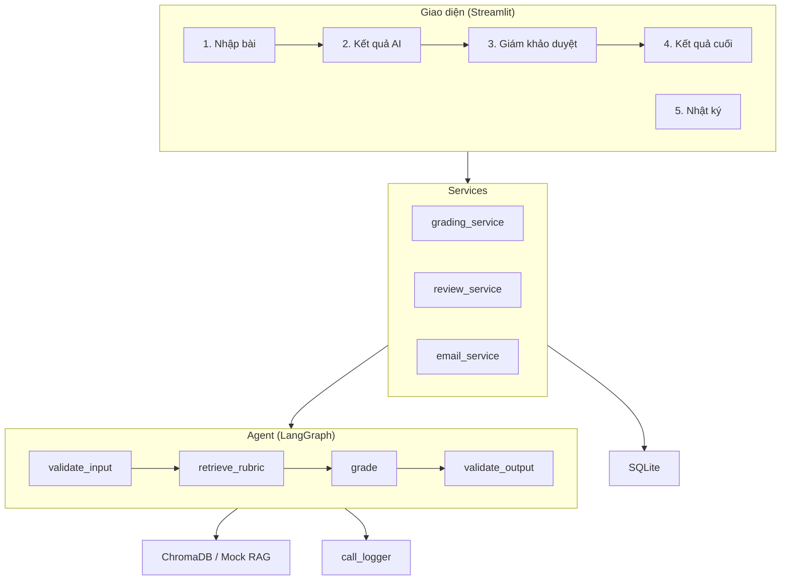

# IELTS Writing AI Assistant

Hệ thống hỗ trợ chấm điểm bài viết IELTS Task 2 sử dụng AI.

## Kiến trúc / Architecture



## Cài đặt / Setup

```bash
python -m venv .venv
# Windows:
.venv\Scripts\activate
# Linux/Mac:
source .venv/bin/activate

cp .env.example .env
make install
make init-db
```

## Chạy ứng dụng / Run

```bash
make run
```

## Kiểm thử / Test

```bash
make check
```

## Phân công vai trò / Role Map

| Role | Phụ trách |
|------|-----------|
| A | Agent, workflow, prompt engineering |
| B | Rubric/RAG, guardrails |
| C | DB, services, email, observability |
| D | Streamlit UI |
| E | Tests, evals, docs, slides |

## Giới hạn hiện tại / Current Limitations

- LLM thực chưa được tích hợp (dùng mock client)
- ChromaDB chưa được index (dùng in-memory keyword fallback)
- SMTP thực chưa được cấu hình (dùng file mode)
- Prompt thực chưa được viết (TODO A2)
