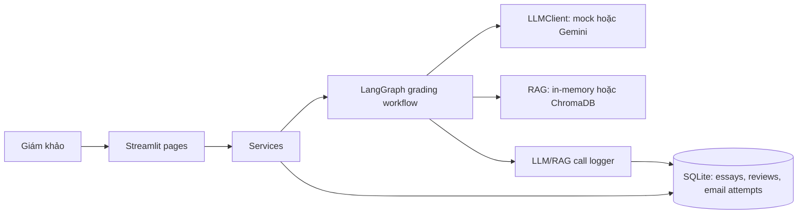

# IELTS Writing AI Assistant

Ứng dụng Streamlit hỗ trợ giám khảo đánh giá IELTS Writing Task 2. AI đề xuất điểm và nhận xét cho bốn tiêu chí; **giám khảo mới là người quyết định điểm cuối, phê duyệt và chủ động gửi kết quả**.

> Đây là công cụ hỗ trợ thử nghiệm, không thay thế giám khảo hoặc quy trình chấm thi chính thức.

## Nguyên tắc và kiến trúc

- AI không phê duyệt điểm và không tự gửi email.
- Overall band được tính trong Python theo quy tắc làm tròn nửa điểm, không nhờ LLM tính.
- Dẫn chứng AI đưa ra phải khớp với nội dung bài viết.
- Mỗi lần chấm lại tạo một AI version mới; không ghi đè version cũ.
- Essay là dữ liệu đầu vào, không phải chỉ dẫn cho AI.
- UI gọi service; service điều phối workflow, LLM, RAG, guardrails, SQLite và logging.



Trạng thái chính của bài: `pending → ai_done → reviewing → approved → emailed`. Nếu chấm lỗi, bài có thể ở `grading_failed`; có thể thử chấm lại. Email có các trạng thái riêng: `sending`, `sent` hoặc `failed`; gửi lại chỉ được phép sau lần thất bại.

## Yêu cầu

- Python 3.11
- Windows PowerShell, macOS hoặc Linux
- Kết nối Internet chỉ cần cho Gemini thật, SMTP thật hoặc cài dependencies

Không cần Docker hay FastAPI. `make` là tùy chọn; các lệnh Python bên dưới dùng được trên Windows.

## Cài đặt lần đầu

Chạy các lệnh từ thư mục gốc của repo. Không chạy script từ một thư mục khác vì đường dẫn `.env` được đọc tương đối với thư mục hiện tại.

### Windows PowerShell

```powershell
Set-Location "C:\duong-dan\toi\ielts-writing-ai"
python --version
python -m venv .venv
.\.venv\Scripts\Activate.ps1
python -m pip install -r requirements.txt
python -m pip install -e .
if (-not (Test-Path .env)) { Copy-Item .env.example .env }
python scripts/init_db.py
```

`python --version` cần báo Python 3.11.x. Nếu PowerShell chặn activate, chỉ mở quyền chạy script cho cửa sổ hiện tại rồi activate lại:

```powershell
Set-ExecutionPolicy -ExecutionPolicy RemoteSigned -Scope Process
.\.venv\Scripts\Activate.ps1
```

Nếu `.env` đã tồn tại, lệnh trên giữ nguyên file thay vì ghi đè cấu hình hoặc credentials của bạn.

### macOS/Linux

```bash
cd /duong-dan/toi/ielts-writing-ai
python3.11 --version
python3.11 -m venv .venv
source .venv/bin/activate
python -m pip install -r requirements.txt
python -m pip install -e .
test -f .env || cp .env.example .env
python scripts/init_db.py
```

## Chạy ứng dụng

Trong terminal đã kích hoạt `.venv`, ở thư mục gốc repo:

```powershell
python scripts/init_db.py
python -m streamlit run app/streamlit_app.py
```

Mở URL được Streamlit in ra, thường là `http://localhost:8501`. Dừng ứng dụng bằng `Ctrl+C` trong terminal đang chạy Streamlit.

Khi chạy lại vào lần sau, kích hoạt `.venv` và chạy `streamlit` như trên. Nếu vừa sửa `.env`, dừng rồi khởi động lại Streamlit để tránh dùng tiến trình/cấu hình cũ.

## Cấu hình: LLM, RAG và email là ba lựa chọn riêng

Các giá trị mặc định trong `.env.example` hướng tới chạy offline:

- `LLM_PROVIDER=mock`: dùng provider giả, không gọi Gemini.
- `USE_MOCK_RAG=true`: dùng keyword retrieval trong bộ nhớ, không truy vấn ChromaDB.
- `EMAIL_MODE=file`: ghi email thành file UTF-8 trong `outbox/`, không gửi thư thật.

Thay đổi một cấu hình không tự chuyển hai cấu hình còn lại. Ví dụ, có thể gọi Gemini thật nhưng vẫn dùng mock RAG và lưu email ở file.

### Biến môi trường có thể ghi đè `.env`

Pydantic Settings ưu tiên biến môi trường của tiến trình hơn giá trị trong `.env`. Đây là nguyên nhân thường gặp khi `.env` ghi `EMAIL_MODE=smtp`, nhưng lệnh vẫn báo lưu vào `outbox/`.

Kiểm tra mode mà Python thực sự nạp (chạy tại repo root, trong đúng PowerShell dùng để chạy ứng dụng):

```powershell
python -c "import sys; sys.path.insert(0, 'src'); from ielts_ai.config import get_settings; print('EMAIL_MODE=' + get_settings().email_mode)"
```

Nếu muốn dùng giá trị trong `.env`, xóa biến override của cửa sổ hiện tại:

```powershell
Remove-Item Env:EMAIL_MODE -ErrorAction SilentlyContinue
```

Hoặc ép SMTP chỉ trong PowerShell hiện tại và các tiến trình con:

```powershell
$env:EMAIL_MODE = "smtp"
```

Sau đó chạy lại lệnh kiểm tra mode. Phải thấy `EMAIL_MODE=smtp` trước khi thực hiện test gửi thật.

## Dùng Gemini thật

Trong `.env`, đặt:

```dotenv
LLM_PROVIDER=real
LLM_API_KEY=<API key Gemini của bạn>
LLM_MODEL=gemini-3.8-flash
```

Chọn model mà API key/tài khoản của bạn được phép gọi. Không gửi API key qua chat, không ghi vào source code và không commit `.env`. Ứng dụng gửi prompt và essay tới nhà cung cấp LLM; chỉ dùng dữ liệu bạn được phép chia sẻ. Gemini thật không đồng nghĩa với RAG thật.

## Dùng ChromaDB thay mock RAG

Đặt `USE_MOCK_RAG=false` trong `.env` để dùng ChromaDB. Script index đọc dữ liệu tại:

```text
data/rubric/ielts_task2_band_descriptors.jsonl
```

Sau khi cập nhật corpus, dựng lại index:

```powershell
python scripts/build_rubric_index.py
```

Repo có JSONL rubric ở đường dẫn trên. Hãy tự xác minh nguồn, độ chính xác và quyền sử dụng dữ liệu trước khi dùng trong sản phẩm thực tế; việc có rubric trong repo không chứng minh hệ thống được chứng nhận hoặc cho điểm chính thức. `USE_MOCK_RAG=false` chỉ đổi retrieval, không đổi `LLM_PROVIDER`.

## Gửi email

### File mode (mặc định, không gửi thật)

Với `EMAIL_MODE=file`, email được ghi vào `outbox/`. Nếu UI báo thành công trong mode này, điều đó chỉ có nghĩa file đã được lưu. Trạng thái DB `emailed` khi đó **không chứng minh email đã được gửi tới người nhận**.

### Gmail SMTP thật

1. Bật xác minh 2 bước cho Google Account, rồi tạo **App Password**. Không dùng mật khẩu đăng nhập Gmail thông thường.
2. Điền `.env`:

   ```dotenv
   EMAIL_MODE=smtp
   SMTP_HOST=smtp.gmail.com
   SMTP_PORT=587
   SMTP_USER=dia-chi-gmail-cua-ban@gmail.com
   SMTP_PASSWORD=app-password
   ```

   Cổng `587` dùng STARTTLS; cổng `465` dùng SSL. Mailtrap là lựa chọn phù hợp để thử nghiệm SMTP.
3. Trong đúng terminal sẽ chạy lệnh, kiểm tra `EMAIL_MODE=smtp` theo phần trên. Nếu có `Env:EMAIL_MODE=file`, xóa biến đó hoặc đặt `$env:EMAIL_MODE = "smtp"`.
4. Gửi test tới địa chỉ bạn kiểm soát:

   ```powershell
   python scripts/send_test_email.py dia-chi-nhan@example.com
   ```

   `Test email sent successfully.` nghĩa là SMTP đã chấp nhận lệnh gửi. `Test email saved to outbox successfully.` nghĩa là **không có thư thật nào được gửi**; kiểm tra lại mode, biến môi trường, thư mục làm việc và `.env`. Không đăng nội dung `.env` hoặc credentials khi nhờ hỗ trợ.
5. Nếu SMTP chấp nhận nhưng không thấy thư, kiểm tra “Thư đã gửi”, “Thư rác”, “Tất cả thư”, địa chỉ nhận và thông báo trả thư. SMTP acceptance không đảm bảo thư đã vào Inbox.
6. Sau khi đổi cấu hình, khởi động lại Streamlit. Trang kết quả cuối phải hiện banner **“Chế độ SMTP: email sẽ được gửi thật qua SMTP.”**

Trong UI, giám khảo phải phê duyệt bài ở trang **Giám khảo duyệt**, sau đó vào **Kết quả cuối**, xem trước người nhận/nội dung, xác nhận và nhấn **“Gửi email kết quả”**. Sau lỗi có thể dùng **“Thử gửi lại”**; gửi thất bại giữ bài ở `approved`. Ứng dụng không tự gửi sau khi AI chấm xong.

## Luồng thao tác trong UI

1. **Nhập bài:** điền **“Email thí sinh”**, đề bài và essay, sau đó nhấn **“Gửi bài chấm điểm”**. Service tạo bài và bắt đầu chấm; dùng essay dài ít nhất 250 từ để tránh cảnh báo độ dài.
2. **Kết quả AI:** chọn bài. Nếu còn `pending`, nhấn **“🚀 Bắt đầu chấm điểm với AI”**; nếu `grading_failed`, dùng **“🔄 Thử chấm lại (Retry Grading)”**. Xem điểm, evidence, cảnh báo và rubric retrieval.
3. **Giám khảo duyệt:** xem các AI version, sửa band/nhận xét; **“Lưu nháp”** chưa phải phê duyệt. Có thể yêu cầu **“Chấm lại”** một tiêu chí trước khi duyệt.
4. Chọn **“Tôi xác nhận phê duyệt kết quả cuối cùng”**, rồi nhấn **“Duyệt”**. Chỉ quyết định này mới chuyển bài sang `approved`.
5. **Kết quả cuối:** xác nhận mode, người nhận và email preview. Chọn **“Tôi xác nhận gửi kết quả đã được giám khảo phê duyệt”**, rồi nhấn **“Gửi email kết quả”**.
6. **Nhật ký hệ thống:** xem metrics và lịch sử gửi; recipient trong tab Email được mask.

## Kiểm thử và lint

Chạy trong `.venv` từ repo root:

```powershell
python -m pytest -q
python -m ruff check .
python -m ruff format --check .
```

Test mặc định không gọi dịch vụ LLM/SMTP thật; pytest được cấu hình loại marker `integration` theo mặc định. Chỉ chạy integration khi đã chủ động cấu hình và chấp nhận tương tác với dịch vụ bên ngoài:

```powershell
python -m pytest -m integration
```

SMTP integration test cần SMTP settings và `SMTP_TEST_TO`; test sẽ gửi email thật tới địa chỉ đó. Không chạy lệnh này như một bước kiểm tra offline.

## Evals

Chạy bộ eval offline mặc định với mock provider:

```powershell
python evals/run_evals.py
```

Kết quả được in ra terminal và ghi vào `evals/results/latest.json`. Chạy variance bằng Gemini thật chỉ khi đã cấu hình `LLM_PROVIDER=real`, `LLM_API_KEY` và `LLM_MODEL`:

```powershell
python evals/run_evals.py --provider real --variance --runs 3
python evals/regrade_probe.py
```

Các lệnh real gọi provider bên ngoài, có thể tiêu tốn quota/chi phí. `regrade_probe.py` cũng là probe real-provider, không phải test offline.

Các metric gồm schema-valid rate, evidence-valid rate, run-to-run variance và guardrail pass rate. MAE bị bỏ qua nếu eval set không có reference bands đầy đủ. Essay hiện tại là synthetic; số liệu mock không phản ánh chất lượng chấm thực tế, còn kết quả real có thể thay đổi theo lần chạy. Hãy xem [docs/evals.md](docs/evals.md) trước khi diễn giải kết quả.

## Troubleshooting

- **Test email báo lưu vào outbox:** mode mà process đọc là `file`. Kiểm tra `EMAIL_MODE` bằng lệnh Python ở trên; biến `Env:EMAIL_MODE` có thể ghi đè `.env`.
- **Đã sửa `.env` nhưng UI vẫn báo mode cũ:** dừng Streamlit bằng `Ctrl+C`, kiểm tra mode trong đúng terminal, rồi khởi động lại.
- **UI báo gửi thành công nhưng không thấy trong Inbox:** xác định UI đang ở file hay SMTP mode. File mode chỉ lưu file; SMTP mode chỉ xác nhận server nhận yêu cầu, không xác nhận giao tới Inbox.
- **SMTP authentication failed:** kiểm tra tài khoản gửi, App Password, host/port và việc bật xác minh 2 bước của Gmail. Không gửi password/log chứa bí mật cho người khác.
- **Chroma/RAG lỗi:** xác nhận file JSONL ở đúng vị trí, dựng lại bằng `python scripts/build_rubric_index.py`, và chỉ đặt `USE_MOCK_RAG=false` sau khi index đã được tạo.
- **Eval mock có evidence thấp hoặc điểm lạ:** mock dùng cho kiểm tra luồng/schema, không phải để đo năng lực chấm.

## Giới hạn và trạng thái dự án

- Cần giám khảo con người xem xét và phê duyệt mọi kết quả cuối cùng.
- Eval set synthetic chưa có reference bands; không thể dùng MAE để xác nhận độ chính xác.
- Rubric corpus, nguồn và quyền sử dụng cần được con người xác minh trước khi dùng thực tế.
- Cần bài viết thật và điểm tham chiếu do giám khảo cung cấp để đánh giá chất lượng.
- Sau Day 5, dự án **feature frozen**: chỉ nhận bug fixes, tests và documentation.
