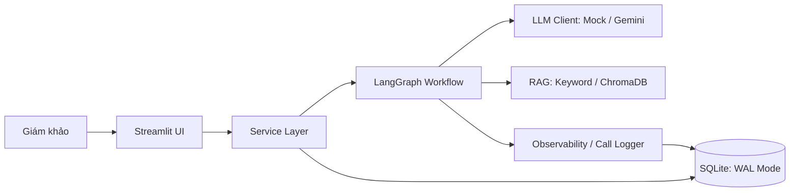

# IELTS Writing AI Assistant

Hệ thống hỗ trợ giám khảo chấm điểm và đánh giá bài viết IELTS Writing Task 2. AI chỉ đề xuất điểm tham khảo và nhận xét theo rubric; **giám khảo con người giữ toàn quyền quyết định điểm cuối, phê duyệt và chủ động gửi kết quả**.

> **Nguyên tắc cốt lõi:** Không để AI tự ý chốt điểm hoặc tự gửi email. Điểm tổng (Overall Band) tính bằng code Python (làm tròn nửa điểm), không để LLM tính. Dẫn chứng phải trích từ bài viết.

---

## Kiến trúc luồng xử lý



- **Vòng đời trạng thái bài viết:** `pending` → `ai_done` → `reviewing` → `approved` → `emailed` (hoặc `grading_failed` nếu gặp lỗi).
- **Luồng gửi email:** Gated chặt chẽ, chỉ cho phép gửi khi trạng thái đã chuyển sang `approved`.

---

## Hướng dẫn cài đặt chi tiết (Setup Guide)

Hệ thống yêu cầu **Python 3.11**. Không cần cài đặt Docker hay FastAPI.

### Bước 1: Chuẩn bị môi trường & Virtualenv

Thực hiện các lệnh tại thư mục gốc của repository:

#### Trên Windows (PowerShell):
```powershell
# 1. Kiểm tra phiên bản Python (yêu cầu Python 3.11.x)
python --version

# 2. Tạo môi trường ảo .venv
python -m venv .venv

# 3. Kích hoạt môi trường ảo
# (Nếu gặp lỗi ExecutionPolicy, chạy: Set-ExecutionPolicy -Scope Process RemoteSigned)
.\.venv\Scripts\Activate.ps1

# 4. Nâng cấp pip và cài đặt dependencies
python -m pip install -U pip
python -m pip install -r requirements.txt
python -m pip install -e .
```

#### Trên macOS / Linux:
```bash
# 1. Kiểm tra Python
python3.11 --version

# 2. Tạo & kích hoạt môi trường ảo
python3.11 -m venv .venv
source .venv/bin/activate

# 3. Cài đặt dependencies
python -m pip install -U pip
python -m pip install -r requirements.txt
python -m pip install -e .
```

---

### Bước 2: Cấu hình môi trường (`.env`)

Sao chép file mẫu:
```bash
# Windows PowerShell
if (-not (Test-Path .env)) { Copy-Item .env.example .env }

# macOS / Linux
test -f .env || cp .env.example .env
```

Hệ thống thiết kế 3 công tắc cấu hình độc lập (mặc định tối ưu để **chạy offline an toàn**):

| Biến môi trường | Giá trị mặc định (Offline/Demo) | Chế độ chạy thật (Production/Live) | Ý nghĩa |
| :--- | :--- | :--- | :--- |
| `LLM_PROVIDER` | `mock` | `real` | `mock`: Dùng canned mock response; `real`: Gọi Gemini API. |
| `USE_MOCK_RAG` | `true` | `false` | `true`: In-memory keyword matching; `false`: Dùng ChromaDB vector store. |
| `EMAIL_MODE` | `file` | `smtp` | `file`: Lưu nội dung vào thư mục `outbox/`; `smtp`: Gửi thư thật qua SMTP. |

#### Khi muốn chuyển sang Gemini thật:
Cập nhật trong file `.env`:
```dotenv
LLM_PROVIDER=real
LLM_API_KEY=your_gemini_api_key_here
LLM_MODEL=gemini-3.5-flash-lite
```

#### Khi muốn chuyển sang ChromaDB RAG thật:
1. Đặt `USE_MOCK_RAG=false` trong `.env`.
2. Dựng persistent vector store một lần:
   ```bash
   python scripts/build_rubric_index.py
   ```

#### Khi muốn chuyển sang gửi Email thật (Gmail SMTP):
1. Bật 2FA trên tài khoản Google và tạo **App Password** (Mật khẩu ứng dụng 16 ký tự).
2. Điền thông tin vào `.env`:
   ```dotenv
   EMAIL_MODE=smtp
   SMTP_HOST=smtp.gmail.com
   SMTP_PORT=587
   SMTP_USER=your_email@gmail.com
   SMTP_PASSWORD=your_16_char_app_password
   ```
3. Chạy thử kiểm tra đường truyền:
   ```bash
   python scripts/send_test_email.py your_recipient@example.com
   ```

---

### Bước 3: Khởi tạo Database SQLite

Tạo cấu trúc bảng SQLite ban đầu (`data/app.db`):
```bash
python scripts/init_db.py
```

---

## Khởi chạy ứng dụng (Run App)

Đảm bảo terminal đang ở thư mục gốc repo và đã kích hoạt môi trường ảo `.venv`:

```bash
python -m streamlit run app/streamlit_app.py
```

Mở trình duyệt tại: `http://localhost:8501`

### Quy trình 5 bước trên giao diện Streamlit:
1. **📝 1. Nhập bài:** Điền email thí sinh, đề bài và bài viết (khuyến nghị ≥ 250 từ). Bấm *Gửi bài chấm điểm*.
2. **📊 2. Kết quả AI:** Xem dự thảo chấm 4 tiêu chí (TR, CC, LR, GRA), Overall Band, dẫn chứng và rubric trích xuất.
3. **⚖️ 3. Giám khảo duyệt:** Điều chỉnh điểm theo nhận xét chuyên môn; có thể yêu cầu AI *Chấm lại (Re-grade)* 1 tiêu chí kèm phản hồi; tích chọn xác nhận và bấm *Duyệt*.
4. **🎓 4. Kết quả cuối:** Xem trước mẫu thư kết quả; tích chọn xác nhận để *Gửi email* (xuất file ra `outbox/` hoặc gửi SMTP tùy cấu hình).
5. **📈 5. Nhật ký (Logs):** Quan sát metrics độ trễ, token, số lần retry và lịch sử cuộc gọi AI/Email đã được mask bảo mật.

---

## Kiểm thử, Lint & Đánh giá (Evals)

```powershell
# Chạy bộ test tự động (65 offline tests hoàn toàn không tốn quota/mạng)
python -m pytest -q

# Kiểm tra cú pháp và định dạng code
python -m ruff check src/ app/ tests/ evals/ scripts/
python -m ruff format --check src/ app/ tests/ evals/ scripts/

# Chạy script kiểm tra tổng thể (Windows PowerShell)
.\scripts\check.ps1
# (Trên macOS/Linux: bash scripts/check.sh)

# Chạy bộ đánh giá chuẩn (Offline Evals với 10 bài synthetic)
python evals/run_evals.py
```

*Lưu ý:* Các integration tests gọi dịch vụ bên ngoài được đánh dấu marker `@pytest.mark.integration` và tự động bỏ qua khi chạy mặc định để bảo vệ quota.

---

## Cấu trúc thư mục chính

```text
ielts-writing-ai/
├── app/                  # Giao diện Streamlit (streamlit_app.py và 5 trang con)
├── src/ielts_ai/         # Mã nguồn chính
│   ├── agent/            # LangGraph workflow, prompts, evaluate logic
│   ├── db/               # SQLite schema (WAL mode) & typed repositories
│   ├── guardrails/       # Kiểm tra input, output, evidence & injection
│   ├── llm/              # Client Protocol, MockClient & RealLLMClient (Gemini)
│   ├── observability/    # Call logger ghi nhận latency, token, retries
│   ├── rag/              # ChromaDB vector store & In-memory keyword retriever
│   └── services/         # Layer điều phối (grading, review, email, metrics)
├── data/
│   ├── rubric/           # 36 chunks rubric Task 2 (Band 1–9 cho 4 tiêu chí)
│   └── eval_set/         # 10 bài synthetic essays phục vụ kiểm định
├── evals/                # Script tính toán metrics (schema-valid, evidence, variance)
├── scripts/              # Tiện ích khởi tạo DB, build index, test mail, check suite
└── tests/                # 65+ unit tests và data-driven guardrail suites
```

---

## Lưu ý trước buổi Demo
- Khuyến nghị sử dụng cấu hình mặc định (`LLM_PROVIDER=mock`, `USE_MOCK_RAG=true`, `EMAIL_MODE=file`) khi thuyết trình demo trên lớp để đảm bảo tốc độ tức thì (~3-5ms), mượt mà và không lo rủi ro nghẽn mạng hay lỗi quota từ API bên thứ ba.
- Tài liệu kiến trúc và quyết định thiết kế chi tiết xem tại `docs/architecture.md` và `docs/decisions.md`.
