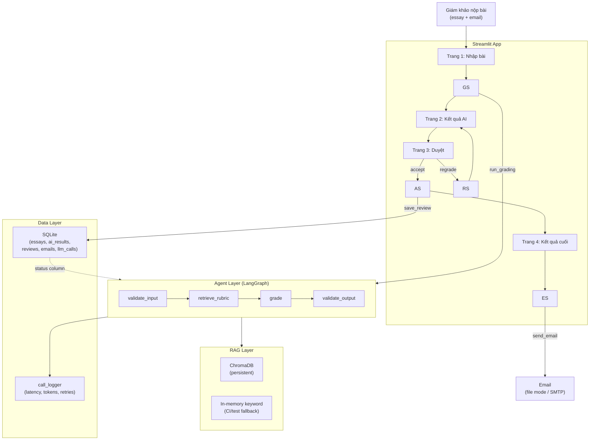

# Kiến trúc hệ thống / System Architecture

## Sơ đồ luồng / Flow Diagram

## Thành phần / Components

| Thành phần | Mô tả | Role |
|-----------|-------|------|
| `agent/graph.py` | LangGraph workflow 4 nodes | A |
| `agent/evaluate.py` | One function: first grade + regrade | A |
| `agent/prompts.py` | Prompt templates (TODO A2) | A |
| `rag/retriever.py` | ChromaDB + mock fallback | B |
| `rag/indexer.py` | Build ChromaDB index from JSONL | B |
| `guardrails/input_checks.py` | Email, word count, length | B |
| `guardrails/output_checks.py` | Band range, evidence in essay | B |
| `db/repo.py` | Typed DB functions, status transitions | C |
| `services/grading_service.py` | Orchestrate essay grading | C |
| `services/review_service.py` | Save review, trigger regrade | C |
| `services/email_service.py` | Send result email | C |
| `observability/call_logger.py` | Log every LLM/retrieval call | C |
| `app/pages/` | 5 Streamlit pages | D |
